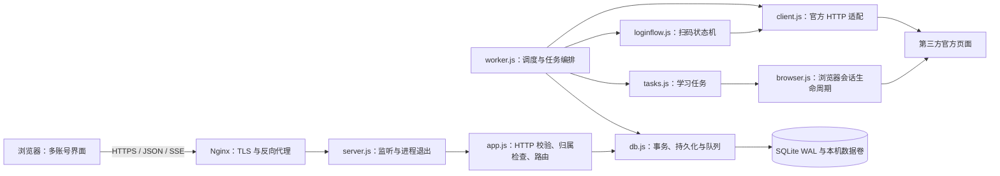

# 多账号任务站：生产 MVP 架构

设计日期：2026-11-06，2026-11-07 移除每周自动计划。基于现有 Node 24 应用演进，保留扫码、积分回查、任务节奏、账号隔离与人工验证的业务行为。本文定义目标结构；实施结果和未完成项见 [重构审查](REFACTOR-REVIEW.md)。

## 方案选择

采用“模块化单体 API + 独立执行器 + SQLite WAL + 浏览器单页”。这是本轮工程选择：已有实现和测试可以复用，单台服务器能够部署、备份和回滚，不引入新的运行依赖。

另一方案是 PostgreSQL、独立队列及前后端框架：适用于多台服务器、更多开发团队和经过测量的容量需求，但当前迁移会扩大故障面。暂不实现。微服务需要跨服务事务及凭据分发，也不适合这个 MVP。

## 组件与边界



HTTP 层不启动执行器；执行器不依赖 Express。`app.js` 导出可独立监听的应用，`server.js` 只管理进程入口。`db.js` 是当前数据库边界，`xxqg/` 是第三方系统边界；暂不增加只有一个实现的仓储接口、依赖注入容器或服务层。

前端继续使用原生 DOM 和 EventSource。账号、日志、验证面板在一页内组合；不是为了目录分层而引入打包器。状态与绘制保留在同一文件，数据未变化时跳过账号面板重建。

## 目录

```text
app/
  public/index.html       页面布局、样式、前端状态与交互
  src/
    app.js                HTTP 应用，不监听端口
    server.js             API 进程入口
    worker.js             登录/任务并发
    loginflow.js          扫码状态机
    db.js                 表迁移、事务、任务队列、事件
    auth.js               签名访客会话、限流
    config.js             环境配置与持久化密钥
    crypto.js             主账号凭据加解密
    messages.js           中文任务名、错误与历史日志转换
    xxqg/client.js        官方请求、CookieJar、真实积分
    xxqg/browser.js       共享浏览器、独立账号上下文、人工输入转发
    xxqg/tasks.js         网页任务执行与结果确认
  test/                   隔离数据库、模拟适配器和浏览器回归
  scripts/                本地启动/停止
  Dockerfile
  docker-compose.yml
  compose.server.yml
docs/
  ARCHITECTURE.md          本方案、数据流、扩容与缓存
  API.md                  HTTP 契约
  REFACTOR-REVIEW.md       问题、根因、边界和验证结果
  MVP-DELIVERY.md          交付入口与运维清单
```

完整实现位于 `app/`，无需从文档复制代码。`data/`、`.env`、研究抓包和真实账号截图不属于代码交付物。

## 数据流与不变量

1. 访问网站后签发 HttpOnly 的 HMAC 访客 Cookie。API 根据服务端解析的访客归属读取账号，忽略请求体中自报的访客 ID。直接访问不需要网站用户名/密码；学习账号仍须本人扫码。
2. 扫码请求写入 `logins`，独立登录循环领取；二维码通过 SSE 展示，确认后更新加密主凭据及登录代次。
3. 手动任务在数据库事务内入队。同账号已有排队、运行、正在暂停或已暂停任务时复用；不同账号可以按执行器并发上限运行。
4. 执行器领取任务、取当前账号凭据、检查归属和登录代次；官方积分作为任务开始、逐项执行及最终完成的依据。数据库缓存不是获分依据。
5. 浏览器进程由一个执行器复用；每个账号使用独立上下文。并发首次创建通过同一个启动 Promise 合并，关闭等待尚未结束的启动。
6. 任务事件入库，API 按任务顺序发送 SSE；当前访客失去账号归属后中止读取。安全验证由用户亲自操作，限时等待，失败停止。
7. 执行器心跳回收失联进程的任务；风险响应不作为网络超时重试。执行器连续两次中断后任务失败并提示人工检查，不无限重新入队；不自动声明已获得积分。

任务队列提供恢复后再次执行的语义，不提供第三方副作用的 exactly-once 保证。恢复时依赖官方进度跳过已完成项；仍须有人监控异常。

## 数据库 Schema

实际 DDL 和兼容迁移唯一来源为 `app/src/db.js`，启动时幂等创建并在事务内补旧列。所有时间戳为 Unix 毫秒；`score_day`、`run_day` 使用北京时间日期。

| 表 | 字段及约束 | 用途 |
| --- | --- | --- |
| visitors | `id TEXT PK`, `created_at INTEGER NOT NULL` | 浏览器访客 |
| users | `uid TEXT PK`, `visitor_id TEXT NOT NULL`, `nick TEXT`, `sealed_cookie TEXT NOT NULL`, `expires_at INTEGER DEFAULT 0`, `created_at INTEGER NOT NULL`, `last_run_at INTEGER DEFAULT 0`, `last_score TEXT`, `score_day TEXT`, `login_generation INTEGER NOT NULL DEFAULT 0` | 账号、加密凭据、积分缓存与授权代次 |
| logins | `sid TEXT PK`, `visitor_id TEXT NOT NULL`, `status TEXT NOT NULL`, `code TEXT`, `state TEXT`, `jar TEXT`, `uid TEXT`, `error TEXT`, `created_at INTEGER NOT NULL` | 扫码状态机；成功登录明文备份保留 7 天 |
| jobs | `id TEXT PK`, `uid TEXT`, `visitor_id TEXT`, `kind TEXT NOT NULL`, `tasks TEXT`, `status TEXT NOT NULL`, `worker TEXT`, `attempts INTEGER DEFAULT 0`, `created_at INTEGER NOT NULL`, `started_at INTEGER`, `finished_at INTEGER`, `error TEXT` | 队列；任务列表为 JSON；queued/running/pausing/paused/done/failed 状态 |
| events | `seq INTEGER PK AUTOINCREMENT`, `job_id TEXT`, `uid TEXT`, `type TEXT NOT NULL`, `payload TEXT`, `created_at INTEGER NOT NULL` | JSON 事件与回放游标 |
| workers | `id TEXT PK`, `seen_at INTEGER NOT NULL` | 进程心跳；ID 含启动 UUID |
| verification_actions | `id INTEGER PK AUTOINCREMENT`, `job_id TEXT NOT NULL`, `kind TEXT NOT NULL`, `x REAL NOT NULL`, `y REAL NOT NULL` | 人工输入转发队列 |
| schedules | `visitor_id TEXT PK`, `enabled INTEGER NOT NULL`, `times TEXT NOT NULL`, `updated_at INTEGER NOT NULL` | 已退役的时间表，仅保留兼容历史 |
| scheduled_runs | `uid TEXT`, `run_day TEXT`, `job_id TEXT NOT NULL UNIQUE`, `PK(uid, run_day)` | 已退役计划的历史记录，用于阻止恢复执行 |
| schedule_pauses | `uid TEXT PK`, `reason TEXT NOT NULL` | 已退役计划的历史暂停记录 |

已有索引：`users(visitor_id)`、`logins(status)`、`jobs(status, created_at)`、`verification_actions(job_id)`、`events(job_id, seq)`。事件索引让单账号日志按任务和游标定位，避免在所有账号事件中逐条过滤；本轮查询计划回归确认它已被使用，无需重复创建。

当前无数据库外键，历史任务按逻辑关系保留。删除账号和变更授权必须通过已有事务/归属检查，不应直接执行运维 SQL 删除活跃账号。

## 缓存与性能策略

- 积分缓存只用于展示：按北京时间失效，同日拒绝较低累计总分覆盖；正式任务始终向官方查分，不用 HTTP 缓存推断完成。
- 浏览器进程缓存：每执行器一个实例，启动请求合并；账号上下文不共享 Cookie。并发数按实际内存设置，先从 1 开始测量。
- 页面渲染缓存：比较待展示的账号状态；完全相同则跳过 DOM 重建。账号切换、新积分、任务状态、额度变化均使其失效。不改变轮询频率和官方请求频率。
- 事件每批最多 200 条、按游标读取，24 小时清理；没有新建 Redis。验证图片是敏感数据，并且会占用数据库和网络，仍需监控数据卷容量。
- 不缩短材料停留和答题时间以追求速度；本轮性能目标是减少浏览器重复启动、数据库无关扫描和无效绘制。

## 部署、扩容与边界

单机使用 Nginx HTTPS + API + worker 两个容器，API 仅绑定回环端口，共享本地 Docker 数据卷和同一密钥。先保留一个 API，按内存增加 worker 数；SQLite 不放网络文件系统。多执行器共享队列事务和账号去重，但总浏览器上下文数会随进程数增加。

扩展到多台服务器前，需将 `db.js` 的事务/队列换成 PostgreSQL 的账号锁和原子领取，将本地 profile/密钥改为受控凭据存储，补全分布式限流及任务租约 fencing。届时再评估 Redis；本轮不创建空实现。

`/healthz` 是存活及执行器数量查询，HTTP 200 不代表任务可执行，运维必须同时检查 `workers > 0`。停止 API/worker 后备份完整数据目录与密钥，恢复测试使用隔离实例；回滚代码前保留数据库备份，不能用旧库覆盖新进度。

此 MVP 的部署边界是小规模、受控使用、有人处理验证。真实多账号长期运行、跨服务器锁、公开运营容量、全量积分和永久免验证均未得到保证。免用户名/密码访问保留原约定，清除 Cookie 或跨设备需重新扫码；不增加网站注册、支付或角色系统。
